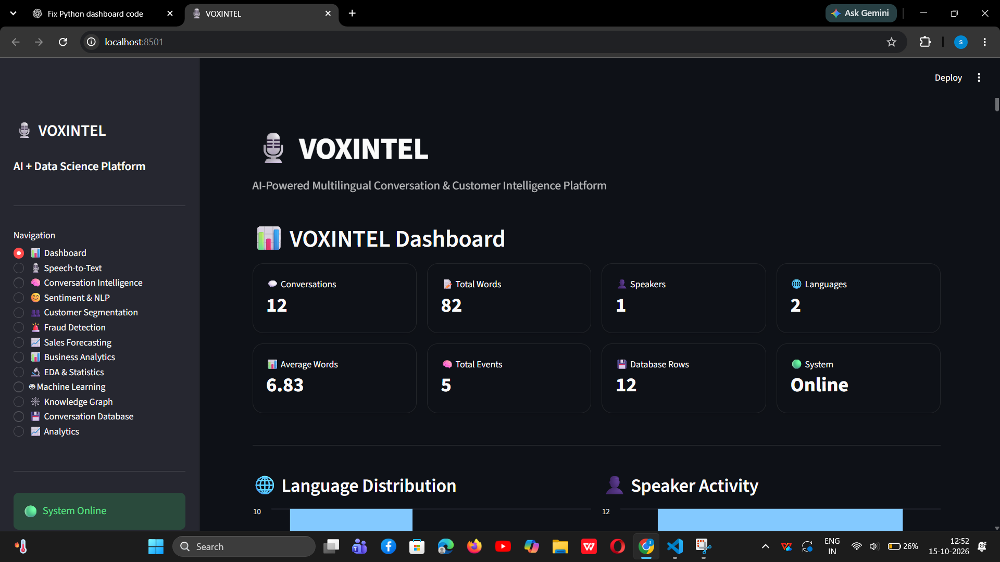

# VOXINTEL
### AI-Powered Multilingual Conversation Intelligence & Memory Engine

VOXINTEL is a Python-based speech and conversation intelligence project that converts spoken input into text, detects language, extracts useful events, analyzes sentiment, and stores conversation information for review and analytics.

The project combines speech recognition, natural language processing, SQLite storage, JSON memory, a knowledge graph, and a Streamlit dashboard.

## Dashboard Preview



## Key Features

- **Speech-to-Text:** Captures microphone audio and converts speech into text using the SpeechRecognition library and Google Speech Recognition service.
- **Multilingual Language Detection:** Identifies the language of a transcript. English and Telugu detection have been tested.
- **Speaker Labeling:** Associates conversations with speaker labels. The current voice pipeline uses a stable session identifier and should not be treated as full multi-speaker diarization.
- **Event Extraction:** Extracts event information such as meetings, reminders, calls, times, and locations from text.
- **Sentiment Analysis:** Uses a multilingual Transformer classifier, with a TextBlob fallback when the model is unavailable.
- **Human Review:** Stores human-reviewed sentiment labels separately from the original AI predictions.
- **Conversation Memory:** Persists conversation history in JSON.
- **SQLite Database:** Saves transcripts, language, speaker, events, sentiment, polarity, subjectivity, and model confidence.
- **Knowledge Graph:** Builds conversation, speaker, language, transcript, and event nodes with relationships.
- **Analytics Dashboard:** Uses Streamlit to present conversation information, sentiment evaluation, and additional analytics modules.

## Processing Architecture

```text
Microphone Audio
       |
       v
Speech-to-Text
       |
       v
Language Detection
       |
       v
Speaker Labeling
       |
       v
Event Extraction
       |
       +------------------+
       |                  |
       v                  v
 JSON Memory          SQLite Database
                          |
             +------------+------------+
             |            |            |
             v            v            v
        Sentiment    Knowledge      Analytics
        Analysis       Graph
             |
             v
       Human Review
             |
             v
      Evaluation Dashboard
```

## Technology Stack

- Python
- Streamlit
- SpeechRecognition and PyAudio
- Google Speech Recognition service
- Hugging Face Transformers
- `tabularisai/multilingual-sentiment-analysis`
- TextBlob
- SQLite
- JSON
- Pandas and other analytics libraries used by the project

## Project Structure

```text
Speech_to_text_translator/
??? voxintel_dashboard.py
??? voxintel.db
??? conversation_memory.json
??? nlp/
?   ??? sentiment.py
??? business/
?   ??? sales_forecasting.py
??? voxintel/
?   ??? voxintel_engine.py
?   ??? analytics/
?   ??? database/
?   ??? intelligence/
?   ??? knowledge_graph/
?   ??? language/
?   ??? memory/
?   ??? speech/
??? tests/
?   ??? test_sentiment_smoke.py
?   ??? test_storage_integration.py
?   ??? test_openai_transcription.py
??? README.md
```

The database and memory files contain local application data. Do not publish them unless you have reviewed their contents and intentionally want to share them.

## Setup

### 1. Open the project directory

```powershell
cd C:\Users\91994\Desktop\Speech_to_text_translator
```

### 2. Activate the virtual environment

If the existing environment is available:

```powershell
.\venv\Scripts\Activate.ps1
```

### 3. Install dependencies

If the repository contains a maintained `requirements.txt`, install its dependencies:

```powershell
python -m pip install -r requirements.txt
```

The application also uses external speech-recognition and model services. Internet access may be required for speech recognition and for downloading the sentiment model.

## Run VOXINTEL

### Launch the Streamlit dashboard

```powershell
streamlit run .\voxintel_dashboard.py
```

Open the local URL printed by Streamlit, typically:

http://localhost:8501

### Run the voice-processing engine

```powershell
python -m voxintel.voxintel_engine
```

The voice engine records speech, generates a transcript, detects language, extracts events, and saves conversation information to JSON memory and SQLite. It also rebuilds the Knowledge Graph and updates analytics.

**Note:** Running the live engine creates a new conversation record. Use the standalone speech-to-text script when you only want to test transcription:

```powershell
python .\voxintel\speech\speech_to_text.py
```

## Run Automated Tests

Run the complete test suite:

```powershell
python -m unittest discover -s tests -v
```

The current automated tests cover:

1. Sentiment classification and language detection.
2. SQLite conversation save and retrieval.
3. Conversation memory persistence.
4. Knowledge Graph integrity.

The OpenAI transcription script is a manual test utility, not an automated unit test.

## Sentiment Evaluation

VOXINTEL compares model predictions against human-reviewed labels and provides a confusion matrix and per-class precision, recall, and F1-score.

The current development dataset contains 12 reviewed conversations. A conservative Neutral override and self-introduction rules were developed using these same examples. The resulting 100% agreement on those 12 examples is an in-sample result, not an independent estimate of model accuracy.

The dataset is imbalanced, so more independently reviewed positive, negative, and neutral examples are needed for meaningful evaluation.

## Current Limitations

- Speech recognition can omit or misrecognize words, especially uncommon project names.
- Google Speech Recognition depends on network availability.
- Transformer model downloads can time out when Hugging Face is unreachable.
- Sentiment overrides are experimental heuristics and may not generalize to unseen text.
- Language detection and sentiment performance need broader validation across supported languages.
- Speaker labeling in the current voice pipeline does not establish reliable speaker identity or full diarization.
- The five automated tests verify selected components, not every dashboard feature or the complete live system under all conditions.

## Future Improvements

- Evaluate stronger speech-recognition models and improve transcription quality.
- Expand multilingual tests using independently reviewed examples.
- Validate sentiment rules on unseen data.
- Improve event extraction and entity resolution.
- Add broader automated integration tests.
- Improve deployment configuration, error reporting, and documentation.

## Project Status

The current prototype has passed five automated smoke and storage integration tests. The original dataset contains 12 conversations, all 12 with human-reviewed sentiment labels.

VOXINTEL is an ongoing development project. Passing selected tests does not imply production readiness or independently validated model accuracy.
